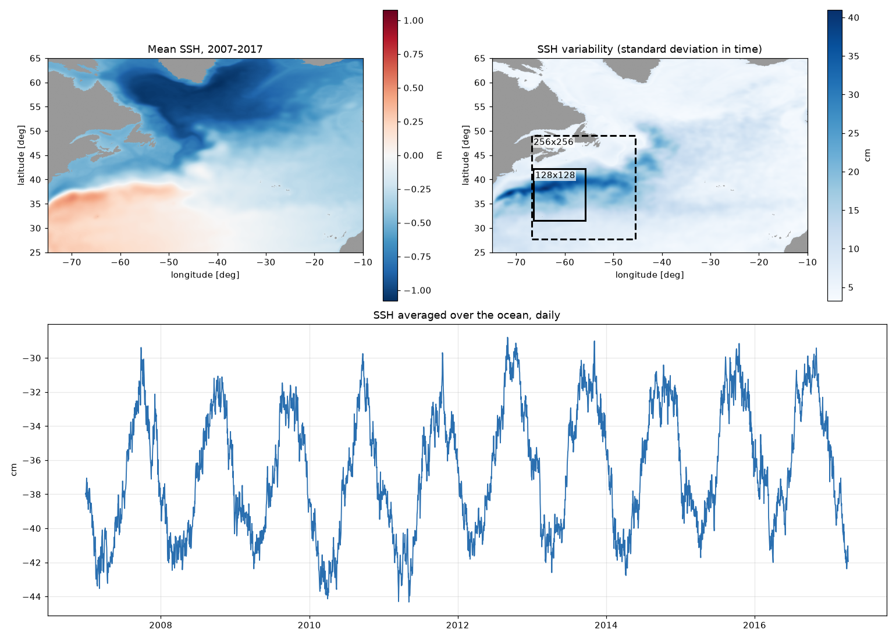
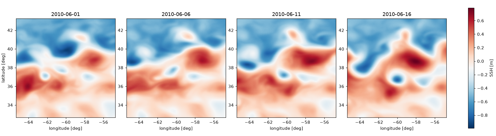
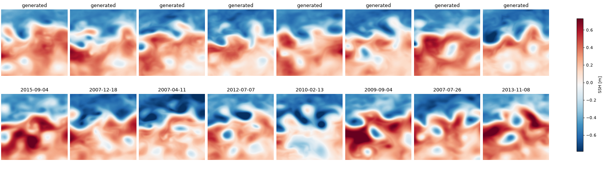

# Learning sea surface height dynamics with Flow Matching

PRAT project, M2 IMA, Sorbonne Université (2026-2027).
Student: Dragomir Božoki. Supervisor: Dominique Béréziat (LIP6).

The goal is to learn the distribution of daily sea surface height (SSH) maps with Flow Matching
(Lipman et al., 2023), first without condition and then conditioned on the date.

## Data

Daily SSH fields (`zos`) at 1/12° over the North Atlantic (25-65°N, 75-10°W), from 27 December 2006
to 6 April 2017 (3734 days, 20 days missing), read from `/users/Enseignants/bereziat/NATL60` on the
PPTI GPU server. The model works on a 128 x 128 region around the Gulf Stream (32.7-43.3°N,
65.3-54.8°W), close to the 33-43°N, 65-55°W box used in the SSH mapping literature.

## Pipeline

| Step | Script | Output |
|---|---|---|
| 1 | `prep.py` | all days in one int16 array (`/tmp/$USER/data`, 2.8 GB) |
| 2 | `stats.py` | mean and variability maps, seasonal cycle, trend, choice of the region |
| 3 | `region.py` | 128 x 128 Gulf Stream region (`data/`, 122 MB) |
| 4 | `train_fm.py` | Flow Matching model and samples every 5000 steps (`runs/fm_uncond/`) |

`data.py` contains the train/test split (half-month blocks in every season with a 5-day gap, or the
last year), the normalization and the date encoding. `unet.py` is the U-Net (16.9 M parameters) that
predicts the velocity v(x_t, t).

pip install -r requirements.txt
python3 prep.py
python3 stats.py
python3 region.py
python3 train_fm.py

## First results

Unconditional model with the optimal transport path, 20000 steps of batch 32 (about 50 minutes on
an RTX 5090). Top row: generated maps (Euler, 50 steps). Bottom row: maps of the test set.

